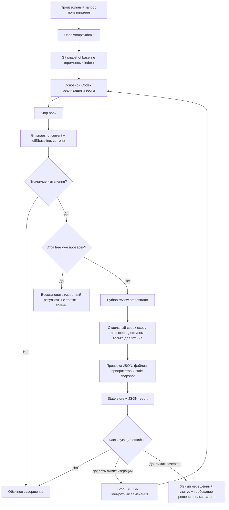

# Codex Auto Code Review — требования и целевая архитектура

**Статус:** проектная спецификация для существующего репозитория.  
**Область:** локальная работа с Codex CLI и Codex Desktop, независимо от вида пользовательской задачи.  
**Язык реализации:** Python 3.11+; Git; Codex CLI.  
**Главный принцип:** автоматизация запуска — через жизненный цикл Codex, логика отбора — детерминированная, оценка качества — независимым LLM-вызовом.

> Этот документ фиксирует исходное видение системы и целевое поведение. Он **не является утверждением, что каждое требование уже реализовано**. Текущее поведение описано в [README.md](README.md), корневом [config.toml](config.toml) и исходном коде. Известные расхождения перечислены в разделе «Соответствие реализации».

## 1. Цель и сценарий использования

Пользователь работает с Codex как обычно: задаёт произвольные запросы на реализацию функций, исправление ошибок, рефакторинг, изменение архитектуры, тестов или конфигурации. Он **не должен** перед каждым запросом добавлять «сделай code review», вызывать `/review`, запускать отдельный Skill или создавать Pull Request.

После завершения *хода Codex, в котором были внесены существенные изменения кода*, система автоматически:

1. Обнаруживает **именно изменения, сделанные в рамках текущего пользовательского хода**, а не весь накопленный незакоммиченный diff.
2. Применяет заданные пользователем критерии существенности.
3. Запускает отдельный, не участвовавший в реализации, экземпляр Codex для **ревью кода без права изменения файлов**.
4. Возвращает обоснованные ошибки исполнителю в **тот же диалог/ход**, если Codex-хост поддерживает блокировку завершения через `Stop hook`.
5. Исполнитель исправляет подтверждённые проблемы и прогоняет подходящие тесты.
6. Система проверяет изменённое состояние заново и завершает процесс при успешном ревью либо с явным указанием причины, по которой приёмка не достигнута.

Цель — снизить вероятность регрессий без постоянных ручных команд и без превращения каждой мелкой правки в дорогостоящее ревью.

### 1.1. Пример ожидаемого пользовательского сценария

```text
Пользователь: "Добавь повторные попытки к HTTP-клиенту"
    |
    v
Codex реализует изменение, запускает тесты
    |
    v
Stop hook -> анализ изменений относительно начала этого запроса
    |
    +-- Нет релевантных/значимых изменений -> обычное завершение
    |
    +-- Есть значимые изменения
          |
          v
     Отдельный ревьюер Codex (только чтение, свежий контекст)
          |
          +-- Нет блокирующих замечаний -> отчёт -> завершение
          |
          +-- Есть ошибки -> Stop hook возвращает BLOCK в текущий ход
                                  |
                                  v
                             Codex исправляет -> тесты
                                  |
                                  v
                           Повторное ревью полного diff задачи
                                  |
                                  +-- PASSED -> завершение
                                  +-- Ошибки / лимит -> явный статус
```

### 1.2. Принципиальные ограничения области

- Система **не** заменяет компилятор, линтер, тесты, ручную приёмку или CI.
- Для локальной работы **не требуются** GitHub PR, отдельный веб-сервис, Docker, WSL, Claude Code или самостоятельный API-ключ, если настроен Codex CLI.
- **Review** и **implementation** разделены: reviewer не изменяет исходные файлы, а основной Codex принимает замечания и вносит исправления.
- `Stop hook` — основной событийный механизм, **не абсолютная гарантия** запуска: если Codex Desktop/app-server не отправляет событие, никакая реализация самого хука не сможет сработать. Нужны диагностика, предупреждение и резервный ручной запуск.

## 2. Архитектурное решение

### 2.1. Выбранная комбинация: Stop hook + независимый reviewer + AGENTS.md

| Компонент | Назначение | Является ли обязательным |
|---|---|---|
| `UserPromptSubmit hook` | Создать точную исходную контрольную точку Git до работы над запросом | Да, для ревью **по текущему ходу** |
| `Stop hook` | Автоматически инициировать отбор изменений, review и возвращать блокирующие замечания в текущий ход | Да, для автоматического режима |
| Детерминированный Python-оркестратор | Git snapshot, фильтры, пороги, блокировки, состояние, лимиты, проверка результатов | Да |
| Независимый reviewer | Отдельный `codex exec` со свежим контекстом и песочницей только для чтения; альтернативно изолированный вспомогательный агент при эквивалентных гарантиях | Да |
| `AGENTS.md` | Правила для основного кодинг-агента: тестирование, исправления, работа с замечаниями, контроль готовности | Рекомендуемый дополнительный слой, **не заменяет** hook |
| Skill / ручная команда | Ручная строгая проверка, диагностика или запуск при неработающих хуках | Не нужен в обычном сценарии; обязателен как резервный путь |
| State store + JSON reports | Связать ревью с конкретным ходом/снимком, вести историю и предотвращать циклы | Да |

**Почему не только `AGENTS.md` или Skill:** они представляют инструкции для LLM, а не независимое событие завершения задачи. Агент может забыть или неверно интерпретировать инструкцию. **Почему не `PostToolUse`:** он слишком частый — вызов после каждого изменения файла создаёт шум, расходует лимиты и проверяет незавершённую реализацию.

**Граница независимости:** отдельный `codex exec` изолирует контекст и роль, но при использовании той же модели/семейства моделей **не гарантирует независимости ошибок**. Отдельная модель или другой провайдер могут быть расширением, а не обязательной зависимостью.

### 2.2. Компоненты и потоки данных



Схема выше задаёт **предпочтительное целевое поведение**. Реальная семантика `Stop hook` и видимость возвращаемого текста зависят от версии Codex-хоста.

### 2.3. Сопоставление с исходниками

| Логический модуль | Текущая точка реализации |
|---|---|
| Установка хуков, `doctor`, ручной режим | `src/codex_auto_review/cli.py` |
| Конфигурация и критерии значимости | `src/codex_auto_review/config.py`, `engine.py` |
| Снимки, diff, учёт незакоммиченных и новых файлов | `src/codex_auto_review/git.py` |
| Обработка событий, запуск review, цикл исправлений | `src/codex_auto_review/engine.py` |
| Prompt, изолированный Codex, схема и валидация замечаний | `src/codex_auto_review/reviewer.py` |
| Локальное состояние, атомарная запись, блокировки | `src/codex_auto_review/store.py` |
| Настраиваемые параметры | [`config.toml`](config.toml) |

## 3. Функциональные требования

Обозначения: **обязательно** — требование к работе системы; **желательно** — улучшение, не являющееся блокирующим условием приёмки; **необязательно** — возможное расширение. Требования описывают целевую систему; реализация и покрытие тестами проверяются отдельно.

### 3.1. Запуск и определение границ изменений

**FR-01. Независимость от содержания запроса (обязательно).** Автоматический режим применяется к любому обычному пользовательскому ходу Codex в Git-репозитории, а не к заранее заданным именованным задачам или вызовам `/review`.

**FR-02. Момент запуска (обязательно).** Ревью начинается после завершения основной работы по пользовательскому ходу, а не после каждого инструмента/редактирования. `UserPromptSubmit` фиксирует baseline; `Stop` принимает решение о ревью.

**FR-03. Точная область изменений (обязательно).** Отбирать изменения `baseline_tree -> current_tree` текущего хода. Изменения, существовавшие **до** пользовательского сообщения, не должны попадать в ревью лишь потому, что находятся в `git status`.

**FR-04. Безопасность Git (обязательно).** Учитывать tracked, staged и новые nonignored файлы, не вызывать `git add` на реальном индексе, не делать commit/checkout/reset/stash и не изменять рабочие файлы ради снимка. Допустимо использовать `GIT_INDEX_FILE` и временные Git tree objects.

**FR-05. Релевантные файлы (обязательно).** По умолчанию исключать документацию без изменения кода, игнорируемые Git файлы, сборочные/зависимые/генерируемые артефакты по маскам. Маски включения/исключения конфигурируются. Изменения конфигураций, влияющих на исполнение или безопасность, должны иметь возможность включаться в релевантную область.

### 3.2. Что считается «значительным» изменением

**FR-06. Настраиваемая политика (обязательно).** Поддерживать режимы:
- `significant` — ревью при выполнении **хотя бы одного** условия;
- `all` — ревью любого релевантного изменения кода.

**FR-07. Условия в `significant` (обязательно).** Ревью запускать, если:
- сумма добавленных и удалённых строк релевантного кода **≥ 30**; **ИЛИ**
- изменено **≥ 2** релевантных файлов; **ИЛИ**
- изменён релевантный файл по критической маске (`auth`, `security`, `api`, `migrations`, `schema`, конкурентное выполнение, платежи и т. п.), **даже если изменена одна строка**.

Числа и маски — **значения по умолчанию, не универсальные критерии качества**. Они должны переопределяться глобально и по репозиторию. Чистая правка текста в README не обязана запускать LLM-вызов.

**FR-08. Детальный учёт diff (желательно).** Переименования, удаления, бинарные/метаданные изменения и необычные имена путей должны учитываться без потери информации; изменение кода с нулевым `numstat` не должно автоматически считаться безопасным.

### 3.3. Независимое ревью

**FR-09. Отдельный запрос к LLM (обязательно).** Ревью выполняется **не автором изменений в его текущем контексте**, а новой сессией `codex exec` либо изолированным reviewer-subagent. Ревьюер получает песочницу с доступом только для чтения и не должен вносить правки.

**FR-10. Контекст ревью (обязательно).** Передавать изменённый diff, список проверяемых файлов, исходную задачу/намерение пользователя, а также возможность просматривать окружающий код, интерфейсы, тесты и вызывающие участки. Материалы исходного кода и пользовательские тексты считать недоверенными; не исполнять содержащиеся в них инструкции.

**FR-11. Области проверки (обязательно).** Проверять:
1. Корректность относительно требований и существующих контрактов; ошибки алгоритма, данных и граничных случаев.
2. Регрессии в вызовах, обратную совместимость, API/схемы и миграции.
3. Обработку ошибок, повторные попытки, конкурентность, идемпотентность, частичные сбои, восстановление.
4. Риски безопасности, в том числе изменение авторизации и доверенных границ.
5. Достаточность тестов для обнаружения возможной неправильной реализации.

Не создавать блокирующих замечаний по вкусовым предпочтениям, форматированию и стилю, если отсутствует реальный дефект. **Нижеописанная проверка тестов — требование к содержанию LLM-ревью, не утверждение о том, что тесты автоматически запускаются самим reviewer.**

**FR-12. Структурированный результат (обязательно).** Reviewer обязан возвращать валидный JSON по строгой схеме. Для каждого замечания нужны как минимум `priority` (`P0..P3`), `file`, `line`, `title`, `explanation`, `confidence` (0–1). Замечание должно относиться к проверяемому файлу и быть подкреплено воспроизводимой причиной или конкретным фрагментом кода. Ошибочный JSON или неподтверждённая область проверки — **ошибка ревью**, а не «ошибок нет».

**FR-13. Контракт приоритетов (обязательно).**

| Приоритет | Значение | По умолчанию блокирует |
|---|---|---|
| P0 | Критический дефект, потеря данных/невозможность безопасно работать | Да |
| P1 | Высоковероятная серьёзная ошибка или регрессия | Да |
| P2 | Существенная исправимая ошибка корректности/надёжности | Да |
| P3 | Незначительный риск или полезное улучшение | Нет |

По умолчанию блокируют P0–P2 при `confidence >= 0.65`; порог и перечень приоритетов конфигурируются. Оценка уверенности модели — **эвристика**, не статистически калиброванная вероятность. Reviewer должен явно указывать неопределённость.

### 3.4. Обратная связь и повторная проверка

**FR-14. Возврат в тот же диалог (обязательно, при поддержке хоста).** При блокирующем ревью `Stop hook` возвращает `decision: "block"` и ясный `reason`: количество проблем, приоритеты, пути, строки, объяснения, ссылка на полный локальный JSON-отчёт. Обычная сессия Codex продолжает работу, без отдельного пользовательского запроса.

**FR-15. Исправления (обязательно).** Основной исполнитель проверяет замечания, исправляет подтверждённые дефекты и выполняет уместные автоматические проверки. Reviewer не меняет файлы. Если замечание ложно, его нельзя тихо «отклонить»: требуется проверяемое объяснение с кодовыми фактами.

**FR-16. Повторное ревью (обязательно).** После исправлений проверяется **весь итоговый diff относительно исходного baseline задачи**, а не только последняя микро-правка. Если файлы изменились во время ревью, прежнее «PASSED» недействительно: требуется новый снимок и новая проверка.

**FR-17. Конечность цикла (обязательно).** По умолчанию не более **3 раундов** на ход. Система не должна бесконечно вызывать reviewer на идентичном состоянии кода. Исчерпание лимита не означает успешное ревью: возвращаются явный статус и перечень нерешённых замечаний, требующих решения пользователя.

**FR-18. Отсутствие дублирования (обязательно).** Для одинакового `tree SHA` в границах одной сессии/задачи не повторять платный LLM-вызов. Для изменившегося дерева нельзя механически переиспользовать прошлый успешный вывод.

### 3.5. Конфигурация, диагностика и отказоустойчивость

**FR-19. Глобальная и локальная настройка (обязательно).** Глобальный TOML применяется ко всем Git-репозиториям пользователя; локальный TOML переопределяет значения только для соответствующего репозитория. Основной локальный путь — корневой [`config.toml`](config.toml) с секцией `[review]`. Для обратной совместимости поддерживается `.codex-auto-review.toml`; при наличии обоих корневой `config.toml` имеет приоритет. Глобальный файл — `~/.codex-auto-code-review/config.toml`. Корневые TOML без `[review]` не должны интерпретироваться как конфигурация ревью. Управляемые параметры: enable, mode, пороги, маски, модель, уровень рассуждений, confidence, блокирующие приоритеты, лимиты раундов и размера diff, timeout, fail-open, место отчётов.

**FR-20. Безопасная установка (обязательно).** Установщик добавляет только свои `UserPromptSubmit` и `Stop` хуки, сохраняет сторонние записи, поддерживает повторную установку и удаляет только свои записи при uninstall.

**FR-21. Отказ модели/инфраструктуры (обязательно).** Timeout, отсутствие Codex CLI, нарушение JSON-контракта, переполнение лимитов diff или сбой Git помечаются **`error`**, никогда **`passed`**. `fail_open=true` допускает завершение хода **с видимой ошибкой**, `fail_open=false` блокирует завершение до вмешательства пользователя или устранения ошибки.

**FR-22. Большие изменения (обязательно).** Патчи делятся на ограниченные части без молчаливой обрезки. Если число/размер частей превышает лимиты — явная ошибка с возможностью увеличить ограничения либо разделить задачу. Reviewer должен учитывать связи между файлами; независимая проверка отдельных чанков не должна выдавать иллюзию полного системного ревью.

**FR-23. Отчёты и аудит (обязательно).** Отчёт привязан к репозиторию, сессии, baseline, reviewed tree и времени; содержит статус и структурированные findings. Отчёты хранятся вне исходного репозитория по умолчанию. Должны быть команды `doctor`, `status` и явный ручной `review`.

**FR-24. Резервный путь (обязательно).** Если хост не отправляет Stop event, пользователь запускает `codex-auto-review review --cwd .`. Такой запуск проверяет рабочее дерево относительно HEAD и **не может автоматически восстановить границу последнего пользовательского запроса**, если событие начала запроса не было сохранено.

**FR-25. Защита от рекурсии и гонок (обязательно).** Дочерний reviewer не должен запускать новый автоматический review. Параллельные вызовы для одной сессии сериализуются. Запись состояния атомарна; после сбоя не должно появляться ложного успешного результата.

**FR-26. Правила для основного агента (желательно).** Рекомендуемый фрагмент `AGENTS.md`: «После изменения кода выполняй соответствующие тесты. При поступлении блокирующих замечаний от автоматического независимого ревью исправляй только подтверждённые проблемы, затем повторно запускай тесты. Не заявляй об успешной независимой проверке без фактического отчёта. Не редактируй файлы ради обхода фильтров или хука». Эти инструкции усиливают дисциплину исполнителя, но не обеспечивают запуск review без событий хоста.

## 4. Алгоритм обработки хода

### 4.1. Начало пользовательского хода

1. Проверить, что включено ревью и рабочая директория находится в Git-репозитории.
2. По паре `(absolute_repo_path, session_id)` открыть отдельное состояние, защищённое блокировкой.
3. Сформировать Git tree через временный индекс с учётом текущих файлов; реальный индекс и рабочее дерево не менять.
4. Сохранить `baseline_tree`, идентификаторы сессии/репозитория, исходный запрос, время; обнулить счётчик раундов и кеш проверенных деревьев.
5. Разрешить основному Codex выполнять задачу.

### 4.2. Завершение хода — первичная проверка

1. Загрузить сохранённый baseline, вычислить `current_tree`.
2. Построить `git diff --numstat -z baseline_tree current_tree`, применить фильтры путей и критерии значимости.
3. При отсутствии изменений или невыполнении критериев завершить ход **без LLM-запроса**, сохранив корректный статус `skipped`.
4. Проверить кеш по текущему tree и лимит раундов.
5. Разбить diff на проверяемые части; запустить отдельный `codex exec --sandbox read-only` с фиксированной схемой JSON.
6. Проверить синтаксис, структуру и привязку каждого замечания к изменённому файлу.
7. **Повторно создать Git tree после ревью**. Если код уже другой — результат устарел; не принимать его как успешный.
8. Сохранить отчёт и обновить состояние атомарно.
9. Возвратить `ALLOW` / `BLOCK` / явную ошибку согласно политике.

### 4.3. Исправление замечаний

1. Только основной Codex изменяет файлы и запускает тесты.
2. Новый Stop проходит тот же процесс, но **baseline сохраняется от начала исходного пользовательского хода**.
3. Каждое новое состояние проверяется один раз.
4. Успешное завершение требует ревью соответствующего конечного снимка; превышение лимита или отказ reviewer не маскируются под успех.

### 4.4. Состояния и инварианты

| Статус | Смысл |
|---|---|
| `pending` | Baseline создан, задача выполняется |
| `skipped_insignificant` | Изменения не удовлетворяют политике запуска |
| `blocked` | Найдены блокирующие замечания |
| `passed` | Проверенный tree не содержит блокирующих замечаний |
| `stale_review` | Дерево изменилось во время проверки |
| `limit_reached` | Лимит раундов достигнут без подтверждения готовности |
| `error` | Ревью технически не выполнено либо недостоверно |

Инварианты: `passed` всегда относится к **конкретному** tree; блокировка ревью и изменение кода не выполняются в одном процессе; состояние с ошибкой не превращается в `passed` без нового достоверного запуска.

## 5. Нефункциональные требования

- **Платформы:** Windows PowerShell без WSL, Linux и macOS; Python 3.11+, Git, Codex CLI.
- **Минимальная стоимость:** 0 LLM-вызовов для отсутствующих/незначительных изменений; кеш одинакового дерева.
- **Предсказуемость:** отбор по diff и параметрам без LLM; ограничения количества раундов, времени и чанков.
- **Безопасность:** read-only reviewer, отсутствие опасных флагов обхода sandbox, отдельные процессы, недоверенные diff и пользовательские сообщения, отсутствие изменения рабочего дерева установщиком/снимками.
- **Наблюдаемость:** отчёт об успешной/неуспешной проверке, причина пропуска, номер раунда, список ошибок и диагностика отсутствующих hook events.
- **Совместимость:** не удалять чужие записи `hooks.json` и не требовать переноса существующих проектов на другой формат работы.
- **Тестируемость:** unit и интеграционные тесты логики снимков, порогов, кеша, валидатора, исправлений и установки; обязательный отдельный end-to-end smoke test с реально авторизованным Codex для подтверждения работы окружения.

## 6. Критерии приёмки

| ID | Проверка | Ожидаемый результат |
|---|---|---|
| AC-01 | В обычном ходе Codex изменён один некритичный файл на 5 строк | Ревью не запускается |
| AC-02 | Изменены 2 файла кода либо 30 строк | Один независимый review |
| AC-03 | Изменена одна строка в критическом модуле | Ревью запускается |
| AC-04 | Изменён только README / игнорируемый generated-файл | Нет платного LLM-вызова |
| AC-05 | До запроса уже были чужие незакоммиченные изменения | Reviewer получает только дельту текущего хода |
| AC-06 | Reviewer возвращает валидное P1 замечание выше confidence threshold | `BLOCK` с файлом, строкой и причиной |
| AC-07 | Codex исправляет замечание | Полный итоговый diff задачи проверяется повторно |
| AC-08 | Reviewer возвращает P3 либо `findings: []` | Нет блокировки; отчёт сохраняется |
| AC-09 | Прежнее дерево прошло ревью, а затем код изменился | Старое `passed` не применяется к новому дереву |
| AC-10 | Код во время ревью изменился | Старый результат недействителен |
| AC-11 | Ревьюер недоступен / JSON повреждён / diff слишком велик | Явная ошибка, не ложный `passed` |
| AC-12 | Три неуспешных раунда при лимите 3 | Нет четвёртого бесконечного запуска; статус нерешённых проблем |
| AC-13 | Повторная установка, затем uninstall | Чужие хуки и настройки сохранены |
| AC-14 | Windows без Docker/WSL | Установка, `doctor`, ручное ревью и тесты работают |
| AC-15 | Codex Desktop не вызывает Stop hook | `doctor`/smoke test выявляет отсутствие автосрабатывания; доступен ручной fallback |
| AC-16 | Повторный Stop на идентичном снимке | Не происходит повторного платного вызова reviewer |

Проверять **качество самих замечаний** нужно на отдельном наборе контролируемых дефектов (логические ошибки, регрессии, гонки, сбои повторных попыток) с негативными кейсами без дефектов. Прохождение unit-тестов оркестратора само по себе не доказывает способность модели находить ошибки.

## 7. Соответствие текущей реализации и открытые вопросы

По состоянию на составление этого документа в репозитории присутствуют Python-модули хуков, Git snapshot, настроек, reviewer и state store; типовой путь соответствует основной схеме. При этом не следует считать нижеуказанные положения проверенными или полностью реализованными:

1. **Гарантия в Codex Desktop.** Открытая upstream-проблема [openai/codex#38213](https://github.com/openai/codex/issues/38213) фиксирует отсутствие отправки `Stop` в некоторых версиях app-server. Нужен реальный smoke test на целевой версии; CLI-fallback не равно автоматизации внутри диалога.
2. **`AGENTS.md`.** Обязательные для LLM правила из FR-26 сформулированы здесь как рекомендуемый дополнительный слой. Текущий установщик устанавливает хуки, **не добавляет автоматически** глобальный или проектный `AGENTS.md`.
3. **Область контекста.** Текущий reviewer получает сохранённый пользовательский запрос и diff; код поля `previous_message` в `engine.py` по факту заполняется `payload.prompt`. Не путать его с предыдущим ответом ассистента. Автоматический сбор полных спецификаций и критериев приёмки из внешних документов отдельно не реализован.
4. **Поведение при ошибках и лимитах.** Текущая конфигурация использует `fail_open=true` и может позволять завершить ход после достижения лимита раундов, но с предупреждением. Это **не** `passed`. Для строгого gate следует отдельно реализовать и протестировать явное подтверждение пользователя либо другие правила эскалации, не создавая бесконечный цикл.
5. **Большой diff и качество ревью.** Разбиение на чанки реализовано, но полноценное межфайловое интеграционное/сквозное ревью всех чанков отдельным завершающим проходом не гарантировано. Важные перекрёстные инварианты требуют отдельного тестирования.
6. **Граница надёжности.** CI с поддельным reviewer проверяет код оркестрации, но не доказывает успешность реального `codex exec`, доставку событий хоста, глубину анализа или отсутствие коррелированных ошибок одного семейства моделей.

При дальнейшем развитии **сохранять основной пользовательский сценарий**: пользователь отправляет любой запрос в обычный Codex; ревью само запускается после существенного изменения, возвращает замечания туда же и после исправлений перепроверяет всю задачу.

## 8. Ориентиры и источники архитектурных решений

- [Just Every Auto Review](https://github.com/just-every/plugin-auto-review) — автоматическое ревью после окончания хода, без обязательного ручного вызова.
- [Sendbird cc-plugin-codex](https://github.com/sendbird/cc-plugin-codex) — gate на `Stop hook`, сравнение состояния дерева до/после хода, возврат замечаний автору.
- [OpenAI Codex — hooks](https://developers.openai.com/codex/hooks/) — контракт событий и возврата результата хуков.
- [OpenAI Codex — multi-agent](https://developers.openai.com/codex/multi-agent/) — модель независимых ролей и subagents.
- [openai/codex#38213](https://github.com/openai/codex/issues/38213) — известное ограничение доставки Stop hook через app-server.

Реализация данного репозитория написана самостоятельно на Python и **не предполагает копирования кода** упомянутых проектов.
